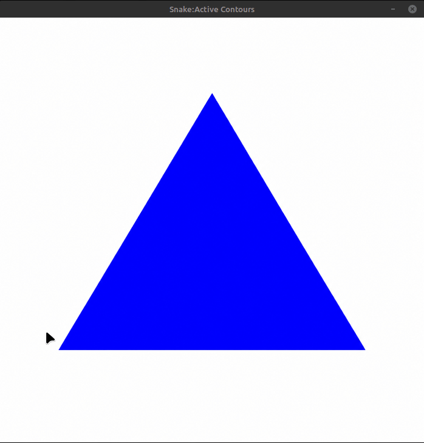
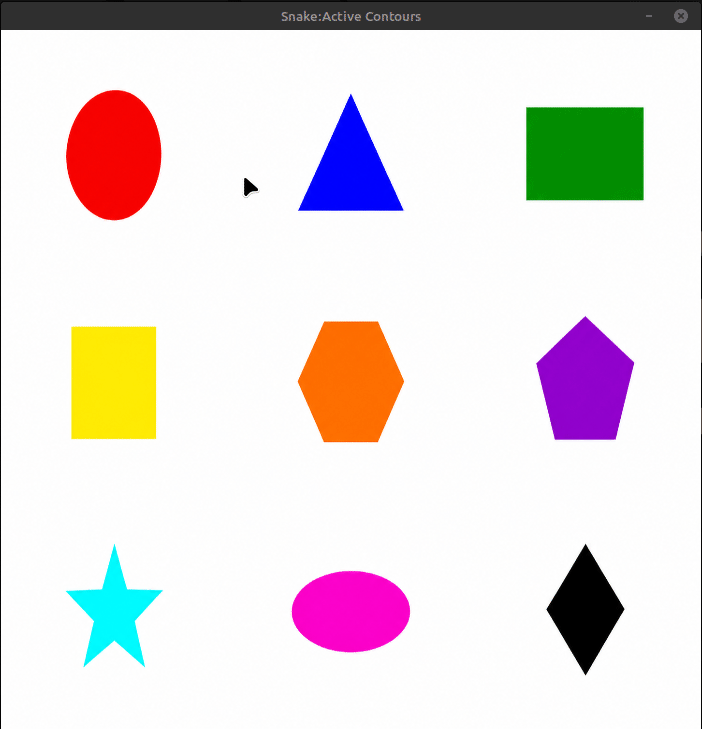

# Snake Active Contour

A naive implementation of the **Snake Active Contour** algorithm from ground up using **C++ and OpenCV**(for visualization purposes only).

This project implements a simple **greedy approach** to active contour optimization. The snake evolves by iteratively moving its control points to minimize an energy function composed of:

- **Elasticity energy:** Encourages contour continuity.
- **Curvature energy:** Encourages a smooth contour.
- **Image energy:** Attracts the contour toward image edges.

The initial contour can be drawn manually using the mouse.

This project is intended as a learning exercise rather than an optimized or production-ready implementation.

## Requirements

- Linux
- CMake
- C++17-compatible compiler
- OpenCV

## Build and Run

From the project root directory:

```bash
cmake -S . -B build
cmake --build build
./bin/Linux/64/{Debug/Release}/app
```

Or execute everything in one command:

```bash
cmake -S . -B build && cmake --build build && ./bin/Linux/64/{Debug/Release}/app
```

After drawing press ```d``` 

## Implementation

The algorithm uses a greedy optimization strategy. At each iteration, every control point searches its local neighborhood for a position that minimizes the energy function:

$$
E_{\text{total}} = \alpha E_{\text{elasticity}} + \beta E_{\text{curvature}} + \gamma E_{\text{image}}
$$

The process repeats until convergence or until the maximum number of iterations is reached.


## Demo


<table>
  <tr>
    <td></td>
    <td></td>
  </tr>
</table>

## Notes

This is a basic educational implementation. It is not intended to provide a robust or optimized segmentation algorithm.
